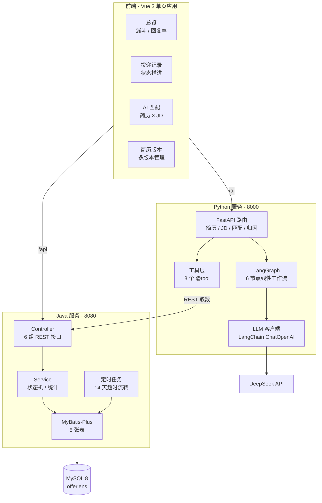

<div align="center">

# OfferLens

**AI 求职工作台 · 投递 → 复盘 → 归因 数据闭环**

把求职当销售漏斗来管：Java 沉淀每一条投递记录，Python Agent 从这些数据里回答「该投什么、为什么没回音」。

[](https://github.com/MANYINUO/OfferLens/stargazers)
[](https://github.com/MANYINUO/OfferLens/network/members)
[](https://github.com/MANYINUO/OfferLens/commits/main)
[](https://github.com/MANYINUO/OfferLens/issues)

[](https://openjdk.org/)
[](https://spring.io/projects/spring-boot)
[](https://www.mysql.com/)
[](https://www.python.org/)
[](https://fastapi.tiangolo.com/)
[](https://langchain-ai.github.io/langgraph/)
[](https://vuejs.org/)

**[功能特性](#-功能特性) · [核心设计](#-核心设计) · [快速开始](#-快速开始) · [接口概览](#-接口概览) · [项目结构](#-项目结构)**

</div>

---

## ⚡ 项目概述

OfferLens 是一个**异构双服务 + 前端的求职数据工作台**。它不是「AI 改简历」——改简历的工具已经够多了，改完照样石沉大海。它要解决的是另一个问题：

> 投了 80 份，回音 5 封。到底是简历不行、渠道不对，还是投错了方向？

要回答这个，得先把投递过程**数据化**：每条投递记下岗位类型、渠道、用的哪版简历、匹配度评分、走到了哪一轮。数据攒起来之后，归因才有依据。

所以项目拆成两个服务，各干各擅长的事：

- **Java（8080）**：业务与数据的唯一入口。投递状态机、超时自动流转、漏斗统计、简历/JD/面试复盘存储。
- **Python（8000）**：AI 分析。简历解析、JD 结构化、匹配评分、LangGraph 六节点工作流、五维漏斗归因。**不直连数据库**，全部通过 Java 的 REST 接口取数。

> **OfferLens** = Offer + Lens（镜头）。不是替你投，是让你看清投出去的每一份去了哪。

### 🚀 五个设计取舍

1. **AI 服务不碰数据库**：Python 侧所有数据都经 `JavaClient` 走 REST 拿。好处是数据一致性只有一处（Java 的事务边界），AI 服务可以随时重启、换模型、扩容，不需要理解表结构。
2. **状态机拒绝跳级**：`applied → viewed → written → first → second → hr → offer` 只能前进一步，任意非终态可转 `rejected / no_response / abandoned`。跳级（`applied` 直接到 `first`）会被 `canTransition` 拦下。
3. **沉默会被自动归档**：14 天没推进且仍是 `applied` 的投递，定时任务自动标记 `no_response`。不靠人记，否则「还在等」会一直污染统计口径。
4. **文本长度三层对齐**：Vue `maxlength` ≤ Python `MAX_TEXT_CHARS` ≤ Java `MAX_CONTENT_CHARS` ≤ MySQL `TEXT` 字节上限。任何一层先炸，用户看到的是 500 而不是「太长了」。
5. **输出必须可追溯**：匹配结果的每条 `hard_met` 都带 `evidence`（简历原文片段），要求 evidence 必须能在简历原文中找到，编造率红线为 0。

### 🏗️ 技术全景

<div align="center">



</div>

---

## ✨ 功能特性

### 前端（`offerlens-web`，4 个页面）

- **总览** `/`：七阶段漏斗分布、回复与 Offer 统计、最近投递、AI 归因面板
- **投递记录** `/applications`：列表、按状态筛选、搜索、新建投递、一键推进状态
- **AI 匹配** `/match`：贴简历 + JD，跑完整 Agent 工作流，拿到分数 / 证据链 / 缺口 / 建议 / 面试题；结果可直接存成投递记录
- **简历版本** `/resumes`：多版本简历文本的保存与删除，支持上传 PDF 提取文字后回填

### Java 后端（`offerlens-java`）

- 简历多版本 CRUD（内容长度上限 20,000 字符，超长返回可读提示而非 500）
- JD 收藏库，按 `(user_id, content_hash)` 唯一键自动去重
- 投递记录 + 七阶段状态机：`advance` 前进一步，`transition` 指定目标并校验合法性
- 面试复盘记录，按用户 / 按投递维度查询
- 漏斗统计：各阶段数量、相邻阶段转化率、offer/applied 整体转化率
- 定时任务：每天 02:00 把 14 天未推进的 `applied` 标记为 `no_response`，另有手动触发接口便于测试
- 全局异常处理：数据完整性、请求体不可读、非法参数统一转成 400 + 中文提示

### Python Agent（`offerlens-python`）

- 简历解析：文本直解 / PDF 提取后解析，两套入口（`parse-text`、`parse-pdf`）
- **纯文本提取** `/api/resume/extract-text`：只提文字不调 LLM，供前端「先看看提取到了什么」再决定要不要花 token
- JD 结构化：硬性要求 / 加分项 / **隐性要求**（如「抗压能力强」→ 加班）
- 匹配评分：分数 + 命中要求带原文证据 + 缺失清单 + 总体评价
- LangGraph 六节点工作流：解析简历 → 解析 JD → 匹配 → 缺口分析 → 定制建议 → 面试题（三层深度）
- 五维漏斗归因：岗位类型 / 渠道 / 简历版本 / 时间段 / 匹配度区间，最后由 LLM 生成带数字支撑的结论
- 8 个 LangChain `@tool` 工具（查职位、查简历、查投递、写投递、推进状态、取漏斗），供 Agent 绑定

---

## 🏗️ 系统架构

### 三个服务

```
offerlens-web (5173)   Vue 3 + Vite，/api → 8080，/ai → 8000（重写为 /api）
        │
offerlens-java (8080)  Spring Boot 3，业务与数据的唯一写入方，MySQL 唯一持有者
        │ REST
offerlens-python (8000) FastAPI，AI 分析，无数据库连接，全部经 JavaClient 取数
        │
DeepSeek API
```

Python 侧的 `JavaClient` 是**唯一**的出站数据通道（`httpx.Client`，超时 10s），这意味着：Java 挂了，AI 功能全部不可用；反过来 Java 完全不需要知道 Python 存在。

### 一次完整的 AI 匹配流程

| 步骤 | 阶段 | 主要操作 | 参与方 | 关键点 |
|---|---|---|---|---|
| 1 | 输入 | 前端提交 `resume_text` + `jd_text` | web | 两侧都 `max_length=MAX_TEXT_CHARS`，空字符串被 validator 拦下 |
| 2 | 编排 | `agent_graph.invoke(initial_state)` | python | 6 节点线性图，任一节点出错写入 `state["error"]` |
| 3 | 解析 | 简历 → `ResumeParseResult` | python | 教育经历字段有默认值，LLM 漏字段不再打断链路 |
| 4 | 解析 | JD → `JDParseResult` | python | 硬性/加分/隐性三分 |
| 5 | 匹配 | 分数 + 证据链 + 缺口 | python | `MatchedSkill` 用 `model_validator` 归一化 `requirement/name/item` 等键名漂移 |
| 6 | 分析 | 缺口分析 → 定制建议 → 面试题 | python | 三次额外 LLM 调用，温度 0.4 / 0.5 / 0.6 |
| 7 | 返回 | 组装 `match_score` / `hard_met` / `suggestions` / `interview_questions` | python | 节点报错时返回 500 并带上节点名 |
| 8 | 落库 | 用户点「存为投递记录」 | web → java | `POST /api/applications`，初始状态 `applied` |

### 前端结构

```
offerlens-web/src/
├── api.ts            两个 Axios 实例：javaClient(/api, 15s) 与 aiClient(/ai, 120s)
│                     统一解包 { code, message, data }，errorMessage() 兼容 FastAPI 422 数组
├── router.ts         4 条路由 + 404 重定向
├── types.ts          与后端契约对应的 TS 类型
├── constants/status.ts   七阶段与终态的展示映射
├── composables/useModalDismiss.ts   Esc / 点遮罩关闭
├── components/       EmptyState、ErrorNotice、SuccessNotice、SkeletonTable、FunnelAttributionPanel
├── styles/           tokens / base / components / views 四层 CSS
└── views/            Dashboard、Applications、Match、Resumes
```

---

## 🧠 核心设计

### 1. 投递状态机：只能前进一步

```
applied → viewed → written → first → second → hr → offer
   ↘         ↘        ↘        ↘       ↘      ↘
        rejected / no_response / abandoned（任意非终态可直达）
```

规则写在 `ApplicationStatus.canTransition(from, to)`：

- 当前状态是终态（`rejected / no_response / abandoned / offer`）→ 拒绝任何流转
- 目标状态是终态 → 放行（只要当前不是终态）
- 否则查 `PROGRESS_ORDER` 索引，**只允许 `toIdx == fromIdx + 1`**

> 把 `offer` 也算进终态集合，是因为拿到 offer 之后还能「推进」在语义上说不通。这条规则让 `advance` 在 offer 上返回 null，前端拿到的是「已到终态，无法继续推进」。

### 2. 沉默自动归档：14 天没动静就是没回音

```java
@Scheduled(cron = "0 0 2 * * ?")
// UPDATE application SET status='no_response', last_followup_at=now
// WHERE status='applied' AND last_followup_at < now-14d
```

一条 SQL 批量更新，不做逐条循环。同时暴露 `POST /api/stats/timeout/run` 手动触发——不然验证这条逻辑得等到凌晨两点。

> 只处理 `applied` 状态：进了 `viewed` 说明 HR 看过，之后沉默是另一回事（可能是流程慢），不该被自动判死。

### 3. 漏斗归因：五个维度，一次 LLM 总结

统计在 Python 侧做（数据从 Java 拉），五个维度各自出一个列表：

| 维度 | 回答的问题 | 字段 |
|---|---|---|
| 岗位类型 | 哪类岗回复率最高？占比多少？ | `job_type` / `total` / `reply_rate` / `offers` |
| 渠道 | 官网 / 内推 / BOSS，哪个值得投？ | `channel` / `reply_rate` |
| 简历版本 | 哪版简历转化率高？要不要统一？ | `resume_version` / `reply_rate` |
| 时间段 | 有没有集体沉默的批次？ | `month` / `reply_rate` / `no_response` |
| 匹配度区间 | 高匹配真的回复率高吗？ | `score_range` / `reply_rate` |

统计结果是**纯数字**，最后交给 LLM 写成「哪类岗该加投、哪版简历该弃用」的结论。数字先算好、模型只做解释，避免让模型自己算百分比算错。

> 「回复」的定义是状态进入 `viewed` 及以上——HR 点开简历才算回复，`applied` 不算。

### 4. 字段命名兼容：一处 `_field` 修掉整片空统计

Java 经 Jackson 序列化返回 camelCase（`jobType` / `matchScore` / `appliedAt` / `resumeId`），而 Python 统计代码历史上按 snake_case 取值。结果不是报错，是**静默读成 None**——统计表里全是「未分类」「未知时间」，看起来像没数据。

`_field(app, camel, snake)` 两种命名都试，任一侧改命名都不会再读空。

### 5. 文本长度：三层必须对齐

```
Vue textarea maxlength  ≤  MAX_TEXT_CHARS(20000)  ≤  Java MAX_CONTENT_CHARS  ≤  MySQL TEXT(65535 字节)
```

`TEXT` 上限是**字节**不是字符，UTF-8 中文占 3 字节，20,000 字约 60,000 字节，留了余量。三处常量写死在不同语言里，改一处必须同步另外两处——代码注释里明确标了这一点。

### 6. PDF 上传：先拦住，再解析

```
后缀校验(.pdf) → 流式读取（1MB/块，累计超 10MB 立即 413）
              → 写临时文件（finally 里删，删失败不覆盖原异常）
              → 页数上限 50 → pdfminer 异常映射 → 无文字层拦截
```

异常被分成五类，全部映射成 **422 + 人话**：

| 异常 | 场景 | 提示 |
|---|---|---|
| `EncryptedPdfError` | 有密码 | 先解除密码再上传 |
| `BrokenPdfError` | 损坏 / 不是 PDF | 文件可能已损坏 |
| `EmptyResumeTextError` | 扫描件、图片导出 | 换带文字层的 PDF，或直接粘贴文本 |
| `TooManyPagesError` | 超过 50 页 | 只保留简历相关页面 |
| `EmptyTextError` | 文本入口传了空串 | 简历文本为空 |

> 扫描件是最常见的坑：文件能打开、能看，但 `extract_text()` 返回空。不拦的话会拿空文本去调 LLM，模型会**编一份简历出来**——这是最坏的失败模式，比报错恶劣得多。

### 7. LLM 输出不可信：键名会漂移

提示词里写 `skill`，DeepSeek 经常返回 `requirement`，偶尔 `name` / `item` / `title` / 甚至裸字符串。早期版本两个坑都踩过：

- 字段必填 → `ValidationError` 打断整条链路
- 字段给默认值 → 不报错了，但 `hard_met` 全是 `{"skill": "", "evidence": "..."}`，**看似成功实则空**

现在的解法是 `@model_validator(mode="before")`：裸字符串 → `{"skill": str}`；字典里 `skill` 为空时按 `requirement → name → item → title → key` 顺序兜底；`evidence` 为 null 时置空串。

### 8. 编造率红线

每条 `hard_met.evidence` 都要能在简历原文中找到：evidence 若对不上原文，就视为一次编造。红线是 0——**证据链是这套评分唯一可信的地方**，一旦 evidence 可以编，分数就只是模型的语气。

---

## 🗄️ 数据库设计

共 5 张表，脚本分两版：`docs/migrations/V001__init_core_tables.sql`（4 张核心表）、`V002__interview_note.sql`（复盘表）。

| 表名 | 说明 | 关键字段 |
|---|---|---|
| `user` | 用户 | `username`(唯一)、`password_hash`、`created_at` |
| `resume` | 简历多版本 | `user_id`、`version_name`、`content`(TEXT) |
| `job_description` | JD 收藏库 | `user_id`、`company`、`position`、`content`、`content_hash` |
| `application` | 投递记录（状态机） | `user_id`、`jd_id`、`resume_id`、`job_type`、`match_score`、`status`、`applied_at`、`last_followup_at`、`notes` |
| `interview_note` | 面试复盘 | `user_id`、`application_id`、`content` |

**索引与约束**

- `job_description`：`UNIQUE (user_id, content_hash)` —— 同一用户重复收藏同一份 JD 直接撞唯一键
- `application`：`INDEX (user_id, status)` —— 列表按用户 + 状态筛选，也是超时任务扫描的入口
- `resume` / `interview_note`：各自 `INDEX (user_id)`

> `application` 表同时存了 `job_type` 和 `match_score` 的**快照**，而不是每次统计都回查 `job_description`。原因是归因要看「当时投的时候是什么情况」——JD 内容后来改了，不该改写历史统计。

---

## 🚀 快速开始

### 环境要求

| 组件 | 版本 | 说明 |
|---|---|---|
| JDK | 17+ | Spring Boot 3 要求 |
| Maven | 3.6+ | 或 IDEA 内置 |
| MySQL | 8.0 | 持久化 |
| Python | 3.11 | 见 `offerlens-python/.python-version` |
| Node.js | 18+ | 前端 |

### 1. 初始化数据库

```bash
mysql -h127.0.0.1 -uroot -p < docs/migrations/V001__init_core_tables.sql
mysql -h127.0.0.1 -uroot -p < docs/migrations/V002__interview_note.sql
```

V001 会创建 `offerlens` 库（utf8mb4）和 4 张表；V002 追加复盘表。

### 2. 配置 Java 数据源

`application.yml` 默认激活 `local` profile，真实密码放 `application-local.yml`（已被 `.gitignore` 忽略）：

```bash
cd offerlens-java/src/main/resources
copy application-local.yml.example application-local.yml
# 填入 MySQL 账号密码
```

也支持环境变量覆盖：`DB_HOST` / `DB_PORT` / `DB_NAME` / `DB_USERNAME` / `DB_PASSWORD`，以及 `SPRING_PROFILES_ACTIVE`。

### 3. 启动 Java 后端

```bash
cd offerlens-java
mvn spring-boot:run
# 或 mvn clean package -DskipTests && java -jar target/offerlens-java-0.0.1-SNAPSHOT.jar
```

自检：

```
GET http://127.0.0.1:8080/api/hello   →  offerlens is running
```

### 4. 配置并启动 Python Agent

```bash
cd offerlens-python
copy .env.example .env      # 填入 DEEPSEEK_API_KEY
.venv\Scripts\python.exe app\main.py
```

> 直接运行 `app/main.py` 而不是 `uvicorn app.main:app`：入口里做了 `os.chdir(ROOT)` 与 `sys.path` 修正。不切工作目录时服务照样起得来、健康检查也正常，但 `.env` 读不到 → `DEEPSEEK_API_KEY` 是空串 → 只有调 AI 时才报错。这个坑比启动失败更难查。

自检：

```
GET  http://127.0.0.1:8000/api/health   →  {"status":"ok","service":"offerlens-agent"}
GET  http://127.0.0.1:8000/docs         →  Swagger 文档
```

### 5. 启动前端

```bash
cd offerlens-web
npm install
npm run dev        # http://127.0.0.1:5173
```

Vite 代理：`/api` → `8080`，`/ai` → `8000` 并重写 `/ai/xxx` 为 `/api/xxx`。AI 请求超时给到 120s（一次完整工作流要 6 次 LLM 调用），Java 请求 15s。

### 6. 演示用户

前端写死 `DEMO_USER_ID = 1`（`offerlens-web/src/api.ts`）。切换用户需改这一处并重启 dev server。**当前版本没有登录体系**，`user` 表只建了结构，`password_hash` 字段尚未被任何代码写入或校验。

---

## 📡 接口概览

Java 统一响应体 `{ "code": 200, "message": "success", "data": {...} }`；Python 直接返回数据体，错误走 HTTP 状态码 + `detail`。

<details>
<summary><b>☕ Java 服务（8080）</b>（点击展开）</summary>

| 方法 | 路径 | 说明 |
|---|---|---|
| GET | `/api/hello` | 启动自检 |
| POST | `/api/resumes` | 创建简历版本（内容 ≤ 20,000 字） |
| GET | `/api/resumes?userId=` | 用户的全部简历版本 |
| GET | `/api/resumes/{id}` | 单份简历 |
| PUT | `/api/resumes/{id}` | 更新简历 |
| DELETE | `/api/resumes/{id}` | 删除简历 |
| POST | `/api/jobs` | 收藏 JD（按 content_hash 去重） |
| GET | `/api/jobs?userId=` | 用户的 JD 收藏 |
| GET | `/api/jobs/{id}` | 单个 JD |
| PUT | `/api/jobs/{id}` | 更新 JD |
| DELETE | `/api/jobs/{id}` | 删除 JD |
| POST | `/api/applications` | 创建投递（初始 `applied`） |
| GET | `/api/applications?userId=&status=` | 投递列表，可按状态筛选 |
| GET | `/api/applications/{id}` | 单条投递 |
| POST | `/api/applications/{id}/advance` | 前进一步（终态返回「无法继续推进」） |
| POST | `/api/applications/{id}/transition` | 流转到指定状态（含终态），非法流转报错 |
| PUT | `/api/applications/{id}/notes` | 更新备注 |
| DELETE | `/api/applications/{id}` | 删除投递 |
| POST | `/api/interview-notes` | 创建面试复盘 |
| GET | `/api/interview-notes?userId=&applicationId=` | 复盘列表 |
| PUT / DELETE | `/api/interview-notes/{id}` | 更新 / 删除复盘 |
| GET | `/api/stats/funnel?userId=` | 漏斗统计：各阶段数量 + 转化率 |
| POST | `/api/stats/timeout/run` | 手动触发 14 天超时流转 |

</details>

<details>
<summary><b>🐍 Python 服务（8000）</b>（点击展开）</summary>

| 方法 | 路径 | 说明 |
|---|---|---|
| GET | `/api/health` | 健康检查 |
| POST | `/api/resume/parse-text` | 文本 → 结构化简历（走 LLM） |
| POST | `/api/resume/parse-pdf` | PDF → 结构化简历（走 LLM，消耗 token） |
| POST | `/api/resume/extract-text` | PDF → 纯文本，**不调 LLM**，返回 `chars` 与 `warning` |
| POST | `/api/jd/parse` | JD → 硬性 / 加分 / 隐性要求 |
| POST | `/api/match` | 结构化简历 + JD → 匹配结果 |
| POST | `/api/agent/analyze` | 一键跑完 6 节点工作流 |
| GET | `/api/funnel/analysis?user_id=` | 五维归因 + LLM 结论 |
| GET | `/api/tools/list` | 列出 8 个 Agent 工具 |
| POST | `/api/tools/call` | 手动调用指定工具（调试用） |

</details>

<details>
<summary><b>⚠️ 错误语义</b>（点击展开）</summary>

| 场景 | 返回 |
|---|---|
| Java 业务失败 | HTTP 200 + `code: 500` + 中文 message（前端 `javaRequest` 按 code 判错） |
| Java 参数非法 | `code: 400` + 具体字段提示（`GlobalExceptionHandler`） |
| Python 入参校验失败 | HTTP 422，`detail` 是数组，前端 `errorMessage()` 取第一条 `msg` |
| PDF 无法解析 | HTTP 422 + 五类异常对应的人话提示 |
| 文件超过 10MB | HTTP 413 |
| 上传的不是 PDF | HTTP 400 |
| Agent 节点内部报错 | HTTP 500 + 节点名（如「简历解析失败: ...」） |

</details>

---

## 📁 项目结构

<details>
<summary><b>点击展开完整目录树</b></summary>

```
OfferLens/
├── docs/migrations/              数据库迁移脚本（V001 核心表 / V002 复盘表）
├── offerlens-java/               Spring Boot 3 后端
│   └── src/main/java/com/offerlens/
│       ├── OfferLensApplication.java   启动类（@MapperScan + @EnableScheduling）
│       ├── common/               Result 统一响应、ApplicationStatus 状态机、全局异常
│       ├── config/               MyBatis-Plus 配置
│       ├── controller/           简历 / JD / 投递 / 复盘 / 统计 / 自检
│       ├── entity/ mapper/       MyBatis-Plus 实体与 Mapper
│       ├── job/                  14 天超时自动流转
│       └── service/              业务逻辑与漏斗统计
├── offerlens-python/             FastAPI + LangGraph 服务
│   └── app/
│       ├── main.py               入口（修 sys.path 与工作目录，uvicorn reload）
│       ├── config.py             .env 加载
│       ├── constants.py          MAX_TEXT_CHARS / MAX_UPLOAD_BYTES / MAX_PDF_PAGES
│       ├── models.py             Pydantic 模型（含 LLM 键名归一化）
│       ├── llm_client.py         LangChain ChatOpenAI 封装，延迟初始化
│       ├── agent/                LangGraph 状态、6 个节点、图定义
│       ├── clients/              JavaClient（唯一出站数据通道）
│       ├── routers/              resume / jd / match / agent / funnel / tools
│       ├── services/             resume_parser / jd_parser / matcher / funnel_analysis
│       └── tools/                8 个 @tool 工具 + TOOL_REGISTRY 兼容表
├── offerlens-web/                Vue 3 + Vite 前端
│   └── src/                      api / router / types / components / styles / views
└── pyproject.toml                项目元数据（Python 依赖见 requirements.txt）
```

</details>

---

## ⚙️ 技术栈明细

| 分层 | 选型 |
|---|---|
| Java | JDK 17、Spring Boot 3.5、Spring MVC、Spring Scheduling |
| 持久层 | MyBatis-Plus 3.5.7（`spring-boot3-starter`）、MySQL 8（InnoDB / utf8mb4）、HikariCP |
| Python | Python 3.11、FastAPI 0.115、Uvicorn 0.30、Pydantic 2.9 |
| Agent | LangGraph 1.2、LangChain 1.4、langchain-openai 1.7、DeepSeek（OpenAI 兼容接口） |
| PDF | pdfplumber 0.11 + pdfminer（异常细分到加密 / 损坏 / 页数） |
| 前端 | Vue 3.5、Vite 7、Vue Router 4（history 模式）、Axios、TypeScript 5.9 |
| 样式 | 四层 CSS：tokens（变量）→ base（重置/排版）→ components（通用件）→ views（页面） |

**代码规模**

| 部分 | 文件数 | 行数 |
|---|---|---|
| Java 主代码 | 27 | 约 1030 行 |
| Java 测试 | 2 | 约 50 行 |
| Python | 26 | 约 1220 行 |
| 前端 Vue | 10 | 约 1240 行 |
| 前端 TS | 8 | 约 410 行 |
| 前端 CSS | 6 | 约 2850 行 |
| **合计** | **约 79 个文件** | **约 6750 行** |

---

## 🤝 贡献指南

- Java 改动跑通 `mvn clean package`，前端改动跑通 `npm run build`（`vue-tsc -b` 会做类型检查）
- 改状态机流转规则，说明 `PROGRESS_ORDER` 与 `TERMINAL_STATES` 是否同步调整
- 改文本长度上限，**三处必须一起改**：`constants.py`、`ResumeController.MAX_CONTENT_CHARS`、前端 `maxlength`
- 改 LLM 提示词或输出结构，说明对编造率的影响
- 一个 PR 只做一件事

---

## 📄 许可证

个人学习与技术验证项目，代码可自由阅读与参考。商业使用请先联系作者。

---

## ⚠️ 免责声明

1. **演示用途**：本项目用于求职数据建模与 LLM 应用的技术验证，**不要直接当生产系统用**。
2. **没有鉴权**：当前版本无登录体系，所有接口以 `userId` 明文传参，`DEMO_USER_ID` 写死在前端。多用户部署前必须补齐身份认证与归属校验。
3. **数据敏感**：简历包含姓名、电话、邮箱，属于个人信息。本地调试请用虚构简历，**不要把真实简历提交到仓库**（`.gitignore` 已排除 `samples/**/*.pdf`）。
4. **模型输出不可全信**：匹配分数、缺口、面试题均由 LLM 生成，页面已提示回看原文，需结合简历原文自行判断。
5. **第三方依赖**：DeepSeek API 需自备 key，费用与合规由使用者承担。
6. **无担保**：代码按「现状」提供，作者不对使用本项目造成的任何损失承担责任。

---

## 🎉 支持与联系

- 遇到问题先看 [快速开始](#-快速开始) 与 [接口概览](#-接口概览)
- 仍未解决请提 [Issue](https://github.com/MANYINUO/OfferLens/issues)，附复现步骤、报错原文、三个服务的版本
- GitHub：[@MANYINUO](https://github.com/MANYINUO)
- 项目地址：[github.com/MANYINUO/OfferLens](https://github.com/MANYINUO/OfferLens)

---

<div align="center">

**如果这个项目对你有帮助，点个 Star ⭐ 就是最大的支持**

<sub>Built with Spring Boot · FastAPI · LangGraph · Vue 3 · MySQL</sub>

</div>
